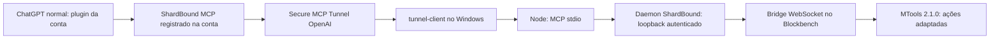

# Auditoria da integração ShardBound Blockbench

Investigação em 03/10/2026, concluindo os testes da web às 21:50 de Brasília. Alvo: Chat normal, conta Plus, Windows. O pacote final é **0.4.1**, consolidando o diagnóstico e as referências. A versão 0.4.0 comprovou status/MTools, e a versão final 0.4.1 executou status novamente em um novo Chat normal da web, às 22:00 de Brasília. O vínculo MCP é o mesmo. A chamada real funcionou no Chat normal da web. A chamada dentro da janela do aplicativo Desktop ainda depende da verificação do usuário; o diagnóstico não apresenta esse resultado como concluído.

## Causa raiz do sintoma original

A versão 0.3.2 reconhecida pelo ChatGPT não tinha uma dependência MCP registrada na conta. Seu pacote publicado continha a skill e um arquivo com comando stdio local, mas **não continha `.app.json`**. O `plugin.json` não declarava `extensions.com.openai.apps`, e o manifesto compatível efetivamente retornado pelo Plugin Creator tinha somente skills/interface, sem apps ou mcpServers. O host recebia instruções, mas não uma conexão MCP de conta para disponibilizar as ferramentas.

Havia um `.app.json` no repositório, mas ele era omitido pela lista de arquivos de `scripts/package.ps1`. Além disso, apontava para uma conexão antiga de Cloudflare, usando o ID da página do catálogo (`plugin_asdk_app_...`) em vez do ID técnico aceito pelo editor (`asdk_app_...`). Esse ID técnico foi confirmado na tela **Gerenciar -> ID do aplicativo**, e o formato foi confirmado pelo erro específico do validador de publicação. A conexão atual usa `asdk_app_6ac1a125e01c81918b4b37cc32bf346b`; sua página tem o prefixo diferente `plugin_asdk_app_`.

O instalador anterior criou outra identidade, `shardbound-blockbench-local` 0.3.3, em um marketplace pessoal. Isso não instalou nem corrigiu o plugin de conta `shardbound-blockbench` 0.3.2 que estava anexado às mensagens. O cache inspecionado tinha apenas o plugin de conta 0.3.2, sem vínculo de apps; não havia instalação em cache do marketplace pessoal. Registrar uma fonte local não equivale a carregar aquele plugin no Chat normal.

As três conexões MCP antigas da conta apontavam para endereços temporários expirados. A conexão chamada Blockbench também indicava nenhuma ferramenta e seu botão Conectar redirecionava a um domínio expirado. O novo fluxo não usa essas conexões.

Não se tratava de falha do token do Blockbench, de MTools ou de um Node incapaz de abrir o caminho com espaços: o cliente stdio independente encontrou 18 ferramentas e executou status. Logs Desktop também registraram `server=shardbound_blockbench status=ready` para a configuração local do cliente Codex, enquanto a conexão antiga `shardbound_blockbench-2` falhava. São mecanismos e evidências diferentes.

## Arquitetura aplicada

O canal externo é o túnel privado da OpenAI. O status local confirmou o componente de proxy externo desabilitado e o control-plane em polling saudável. Não há Quick Tunnel, URL temporária, página de senha OAuth da bridge ou dependência de Work como host final. Stdio continua sendo o transporte interno entre tunnel-client e Node.

A documentação oficial descreve o vínculo de apps registrados por `.app.json`, e apresenta marketplaces locais para autoria/testes com disponibilidade dependente da superfície; a seção de marketplace menciona Work/Codex no Desktop. Ela não fundamenta prometer que um plugin de conta com um comando stdio incluído no ZIP iniciará esse comando no Chat normal. O caso concreto foi resolvido por uma dependência MCP de conta. Não foi feita a alegação universal de que todas as versões do Desktop são incapazes de iniciar stdio. [Plugins e manifests](https://developers.openai.com/plugins/build/plugins), [plugins nas superfícies ChatGPT](https://learn.chatgpt.com/docs/plugins).

O Secure MCP Tunnel é o caminho oficial para ligar o ChatGPT a um MCP privado por um cliente local. O cadastro deve selecionar **Túnel**, não usar o endereço de API do túnel como URL pública MCP. O acesso do runtime usa a chave com Tunnels Read + Use. O MCP não adiciona outro OAuth nesse fluxo. [Secure MCP Tunnel](https://developers.openai.com/api/docs/guides/secure-mcp-tunnels).

## Problemas encontrados durante o novo cadastro

O túnel estava parado na retomada, e o formulário inicialmente informou endpoint não encontrado. Após iniciá-lo, os eventos reais `openai-mcp` comprovaram initialize e tools/list, mas o cadastro retornou uma rejeição genérica de configurações. Os descritores não tinham títulos e seus vetores/arestas eram tuplas Zod que publicavam `items` como lista de schemas.

Foram adicionados títulos e substituídas as tuplas homogêneas por arrays de tamanho fixo, mantendo a mesma validação de dimensões e limites. A atualização parcial ainda foi rejeitada; o cadastro com todos os descritores corrigidos foi aceito. A interface não forneceu o nome do campo rejeitado, portanto a atribuição desse erro especificamente à representação dos arrays é uma inferência sustentada pelos testes, não uma mensagem detalhada do backend.

Também foi observada diferença entre runtime vivo/pronto e descoberta MCP. O diagnóstico agora verifica o control-plane e registra separadamente a observação initialize/tools/list. Depois de reiniciar o servidor durante os testes, foi necessário reabrir o formulário para obter uma descoberta nova. Nenhum erro de tentativa é apresentado como uma criação bem-sucedida.

## Alterações aplicadas

- Identidade, escopo privado USER e defaultPrompt do plugin original preservados; publicação 0.4.0 feita no mesmo plugin.
- `.app.json` incluído no ZIP e referenciado nos manifests portátil/compatível, com o ID técnico verificado da conexão Tunnel.
- `mcp.json` e `.mcp.json` neutralizados no pacote de conta, evitando descoberta duplicada de stdio e app. O cliente local Codex mantém sua configuração separada.
- Empacotamento verifica o ZIP efetivo, referências, identidade/versão e exclusão de `.local`, tokens, DPAPI, modelos, outputs e node_modules. Flags antigas que publicavam caminhos de máquina/URLs foram recusadas com orientação correta.
- `Install-ChatGPT-Desktop-Plugin.ps1` substitui o registro de marketplace como fluxo principal pelo runtime Tunnel e diagnóstico completo.
- `Connect-ChatGPT.ps1` resolve o executável Node absoluto; usa argumentos compatíveis com o parser do tunnel-client e URI de arquivo codificada, validado no caminho com espaços deste projeto. Evita runtime duplicado, espera polling saudável, preserva variáveis de ambiente anteriores e não imprime credenciais.
- Chave existente preservada em DPAPI. O perfil nativo do tunnel-client foi inspecionado somente para comprovar que usa referência `env:` à chave, sem valor literal. O Git não recebe esses arquivos.
- Migração faz backup e remove somente a entrada de marketplace `shardbound-blockbench-local`; também desativa somente a conexão expirada `shardbound_blockbench-2` no config do usuário. Outros plugins e o MCP stdio válido foram preservados. Não houve exclusão manual de caches.
- Atalhos npm e scripts que iniciavam o transporte temporário foram desativados. A implementação HTTP/OAuth fica disponível para outros clientes e testes; não é o caminho do Chat normal.
- Skill, README e guia Desktop corrigidos; a skill não diagnostica ausência de tools automaticamente como falha de spawn.
- Diagnóstico inspeciona manifests, cache, instalação/processos/logs Desktop, pairing, handshake Node stdio, todas as ferramentas, status, daemon, controlador, polling e catálogo do túnel. Distingue observações históricas de registro/publicação, teste independente, descoberta e chamada real.
- Auditoria MCP registra somente data/processos/cliente/método/nome de ferramenta/sucesso. Não grava parâmetros, modelos, resultados, imagens ou segredos.

O editor do Plugin Creator sobrepõe arquivos e não permite excluir arquivos antigos. Arquivos legados publicados foram neutralizados quando necessário; arquivos históricos omitidos não foram apresentados como removidos. As definições antigas da conta não foram apagadas permanentemente; o novo plugin não as referencia.

## Evidências reais

| Camada | Resultado e limite |
| --- | --- |
| Desktop instalado | MSIX OpenAI.Codex / ChatGPT.exe, versão 26.930.3930.0; arquivos, config, cache e logs acessados pelo terminal |
| Node | 26.4.0, `C:\Program Files\nodejs\node.exe`; spawn real em diretório com espaços |
| MCP independente | Initialize, tools/list com 18 tools, status respondido; prova do cliente de diagnóstico |
| Daemon/editor | Loopback 30123 autenticado; Blockbench 5.2.1 respondeu, MTools 2.1.0 instalado |
| Túnel | v0.0.15; polling saudável, Node filho iniciado; initialize/tools/list observados da OpenAI |
| Cadastro de conta | ShardBound MCP conectado; tela de ferramentas mostra 12 Write e 6 Read |
| Publicação | Plugin Creator retornou 0.4.0 e a leitura posterior confirmou `.app.json`, os dois vínculos, MCPs vazios e skill corrigida |
| Chat normal web | `status` e `mtools_list` chamados com sucesso pelo cliente `openai-mcp` às 00:50:02 UTC; UI confirmou resultado |
| Modelo naquele teste | `java_block`, 13 elementos, revisão 107; o teste não alterou nada. Para editar, abra Generic Model (`free`) |
| MTools | 19 ações automatizadas; resposta do Chat informou 15 disponíveis naquele estado e 4 indisponíveis |
| Testes | 23 testes passando: bridge, transportes, auth, schemas, MTools, arquivos, auditoria e ZIP |
| Instalador | Execução real reutilizou runtime e retornou código 0 |
| Diagnóstico estrito Desktop | Retornou código 2: teste no Chat web observado, chamada dentro da janela Desktop ainda não comprovada |

Chat da release final: [Status 0.4.1](https://chatgpt.com/c/6ac1a534-4954-83e8-98d3-ab8cbdfefbe0).

Chat de prova de MTools: [Teste de integração](https://chatgpt.com/c/6ac1a280-d78c-83e8-bca6-7b66766a9180).

Capturas e registros locais ficam em `.local/chatgpt-status-proof.png`, `.local/chatgpt-tools-proof.png`, `.local/chatgpt-host-verification.json`, `.local/chatgpt-diagnostic.json` e `.local/mcp-audit.jsonl`. São ignorados pelo Git. O snapshot de instalação/cache/logs não é tratado como prova de que uma conversa Desktop carregou a release atual.

## Uso e última verificação

Depois de reiniciar o PC, rode `.\Connect-ChatGPT.ps1` na pasta bridge. Deixe o Blockbench aberto com o plugin pareado carregado. Abra um novo **Chat normal** no Desktop, selecione **ShardBound Blockbench** e peça `Execute somente status no meu Blockbench, sem editar nada`. A conexão de conta já foi cadastrada e conectada, portanto não é necessário criar outra nem repetir autenticação por senha da bridge.

O único teste de host ainda pendente é essa chamada na janela Desktop. A skill [Computer Use](C:/Users/Sistemas/.codex/plugins/cache/openai-bundled/computer-use/26.930.31730/skills/computer-use/SKILL.md) remete ao guia que determina **“Do not automate the ChatGPT desktop app UI”**; por isso foi usado o navegador para o teste normal Chat e o terminal para inspeção da instalação. [Regra exata](C:/Users/Sistemas/.codex/plugins/cache/openai-bundled/computer-use/26.930.31730/docs/guidance.md).

Não foram testadas alterações de geometria/textura no modelo atual, pois ele não é Generic Model e a tarefa foi reparar a integração. As proteções existentes de projeto/revisão, Undo e MTools foram preservadas e verificadas pela suíte. O servidor só automatiza as ações MTools explicitamente adaptadas.
