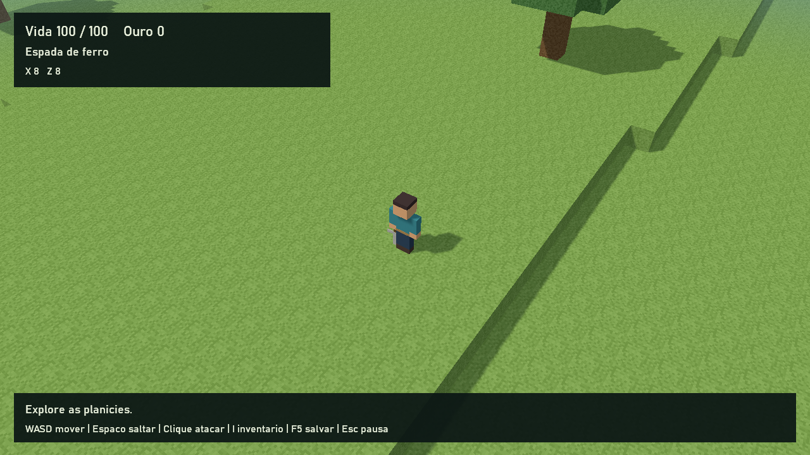

# Mundos procedurais, menu inicial e conteúdo por mods

Direção solicitada e implementada em 2026-10-17: substituir a aventura fixa
na execução padrão por mundos gerados pela seed, com blocos, muito pouco relevo
e sem cavernas, mantendo a câmera elevada e o movimento WASD.

## Jogar e configurar

Depois de compilar com `tools/build.ps1 release`, execute
`build/release/game.exe`. A tela inicial oferece Jogar, Configurações e Sair.
Jogar abre a lista de mundos; Criar mundo exige nome e permite seed em texto
ou número. Seed vazia recebe um número aleatório. IDs internos aleatórios
separam mundos mesmo quando seus nomes e seeds são iguais.

As configurações são aplicadas imediatamente e persistidas em
`build/<preset>/user/settings.json`: volume mestre, VSync, tela cheia,
sombras, escala de renderização (100%, 75%, 50%) e distância de 2–5 chunks.
Também estão disponíveis no menu de pausa. ESC pausa/retoma; a simulação
fica suspensa nas telas do menu. Digitação usa eventos SDL de texto UTF-8;
TAB alterna nome/seed e Backspace remove um caractere completo.

WASD move, Espaço salta, clique esquerdo ataca mirando pelo cursor,
I abre o inventário, Q seleciona equipamento e E equipa. F5 salva o mundo.
Há salvamento automático a cada 60 segundos de jogo, na criação/abertura,
ao fechar normalmente e em Salvar e voltar ao início.
Se F5 ou o salvamento automático falhar, a pausa abre imediatamente com o erro.
O aviso permanece ao visitar as configurações; salvar com sucesso o remove.
É possível tentar novamente em Salvar mundo ou reconhecer o erro em
Continuar sem salvar (ou ESC). Uma tentativa malsucedida de salvar e voltar
ao início mantém o mundo aberto.

## Onde está o conteúdo

| Pacote | Responsabilidade |
| --- | --- |
| `content/foundation` | Scripts, modelos e sons de jogador, inimigos, equipamentos, combate, loot, inventário e HUD. |
| `content/plains` | Blocos, PNGs provisórios, gerador de planícies, estruturas e distribuição dos encontros. |
| Runtime C++ | Carregar/validar definições, interpretar scripts, gerar/descartar chunks, malhas, colisão, origem flutuante, menu, configurações e saves. |

O modo procedural não chama `registerCoreModels`. Os modelos/sons usados no
jogo normal são registrados por `assets.json` dos mods e usam seus namespaces.
Os recursos `core:*` anteriores permanecem apenas para exemplos e regressão.
Ao configurar um build anterior, CMake move a cópia antiga de
`content/adventure` para `retired-content/`, preservando seus arquivos fora da
descoberta padrão. Outros mods instalados pelo usuário permanecem no lugar.
O conteúdo da aventura anterior fica em `examples/legacy/adventure`; é possível
abri-lo explicitamente com `--mods examples/legacy`. Seus saves não são
convertidos automaticamente para o terreno procedural.

## Contrato `world.json` v1

Cada mod pode fornecer um `world.json` com `version: 1` e seções opcionais
`blocks`, `structures`, `biomes`, `generators` e `generator_extensions`. Definições novas usam o namespace do
próprio mod. As referências são verificadas após combinar os pacotes.
Dependências entre mods continuam declaradas em `mod.json`.

Um bloco declara `texture` (ID de textura de um mod) e `solid` (booleano).
O placeholder usa uma textura em todas as faces. Texturas passam pelo pipeline
normal de assets, com amostragem nearest e cache por conteúdo.

Uma estrutura é uma lista de células `[x, y, z, "mod:bloco"]`, com até 512
células, x/z entre -6 e 6 no modo `scatter` (-3 a 3 no legado) e y entre 0 e 15. O gerador escolhe uma posição
interna e uma rotação de 90 graus pela seed; os limites mantêm as estruturas
dentro do chunk. Células duplicadas e referências ausentes são rejeitadas.

Um gerador declara nome, blocos `surface`/`fill`/`rock`, `base_height`,
`relief`, `period` e lista `structures` com IDs e probabilidades 0–1.
Sem `structure_mode`, mantém o modo legado: a primeira entrada selecionada
ocupa o chunk. Em `scatter`, várias regras com IDs estáveis são avaliadas,
com filtros de bioma/altura/inclinação, tentativas, espaçamento e rotações.
`safe_radius` protege a área inicial; o padrão 0 protege o chunk (0,0).
Não há lista fixa de posições de árvores, paredes, regiões ou encontros no C++.

`plains:gentle` usa base 4, relevo 1 e período 64, resultando em alturas
de 3–5 blocos. Ruínas, árvores e flores são dados do mod, com sorteio
independente da ordem em que o jogador visita os chunks.
Novos mundos usam Pradaria e Bosque aberto, com distribuição própria de árvores
e flores. Mundos antigos preservam a definição anterior salva.
O [guia de geração para mods](modding/06-WORLD-GENERATION.md) documenta todos
os campos, herança, extensões e o exemplo executável `gardens`.

## Seed, chunks e precisão

Seeds são strings UTF-8 exatas: `123`, `0123` e `123 ` são seeds diferentes.
Um hash FNV-1a de 64 bits e mistura inteira por coordenada alimentam o
ruído interpolado e os sorteios. Não há dependência do relógio, da ordem de
carregamento ou de `std::hash`. A aleatoriedade só escolhe a seed quando
o usuário deixa o campo vazio.

Chunks têm 16×16 colunas e armazenamento vertical de até 48 blocos nesta
versão. A malha omite faces internas e entre terrenos adjacentes. Colunas
de mesma altura compartilham caixas de colisão; blocos sólidos das estruturas
possuem caixas próprias. A colisão acompanha o anel imediato ao jogador e os
chunks ocupados por corpos dinâmicos, incluindo suas bordas e uma margem de
movimento. Esses chunks permanecem carregados mesmo fora da distância visual
e são liberados quando deixam de sustentar entidades e saem do alcance do jogador;
chunks visuais adicionais são construídos gradualmente, com orçamento de dois
novos chunks por atualização. A chegada e o anel de colisão são preparados
antes de permitir a simulação, evitando quedas em terreno ainda não gerado.

Coordenadas globais usam inteiros de 64 bits. A origem é deslocada quando o
jogador se afasta 128 unidades; posições de física/renderização permanecem
locais. As malhas existentes são reutilizadas no deslocamento. O mundo não
possui borda de gameplay nem tamanho pré-gerado. Há um limite técnico de
segurança de ±10¹² blocos, além dos limites físicos de armazenamento/memória.
Isso não representa infinitude matemática.

## APIs adicionais para mods

| Função | Contrato |
| --- | --- |
| `terrain_height(x, z)` | Altura do chão nas coordenadas locais x/z; não inclui o topo de árvores/estruturas. |
| `terrain_clear(x, z)` | Indica se há espaço sem blocos sólidos nos três blocos acima do chão. |
| `world_origin()` | Record com deslocamento global x/z. Some à posição local de uma entidade para obter coordenadas globais. |
| `world_seed()` | Seed textual do mundo atual. |
| `world_generator()` | ID do gerador escolhido. |
| `world_random(x, z, salt)` | Número determinístico em [0,1), usando coordenadas globais inteiras e salt. |
| `on_world_start` | Evento de mundo novo; o mod de gameplay deve criar/possuir seu jogador. |

`on_start`, `on_ready`, `on_before_save`, `on_saved`, `on_loaded` e os
eventos de atualização continuam disponíveis. `foundation` usa definições
`Encounters` fornecidas por outros mods para decidir inimigos por célula;
as regras de ataque/drops são scripts. Equipamentos Studio usam anexação
e clips `idle`, `run`, `jump`, `attack` quando disponíveis.

## Persistência

Cada mundo fica em `user/worlds/<id>/` com `world.json` e `checkpoint.json`.
A metadata guarda nome, seed, gerador, versões de mods e uma cópia do contrato
de geração. Editar parâmetros de terreno/estruturas de um mod afeta mundos
novos; mundos existentes continuam usando sua cópia. Alterar os pixels de
uma textura continua refletindo nos mundos existentes depois de recompilar
e reiniciar. Mods e versões exigidos pelo save são conferidos antes da abertura.

O checkpoint usa o formato de saves existente e inclui jogador, inventário,
entidades persistentes e estado por mod. A origem global é gravada no estado
reservado `core`, na mesma escrita atômica das posições locais. Isso também
vale para saves solicitados por scripts. Chunks e seus corpos de colisão
são regenerados e não entram no checkpoint. A origem recebida é validada
antes de trocar o mundo; um arquivo inválido preserva o estado em execução.

O mod conserva encontros derrotados e descarrega inimigos distantes. Loot
distante vira registros de coordenadas globais no estado do mod e volta a
ser entidade ao se aproximar. Escritas de settings/metadata/checkpoints usam
arquivo temporário e substituição atômica; revisões anteriores têm `.bak`.

## Verificação e limites

`procedural_tests` verifica seeds iguais/diferentes, coordenadas negativas e
distantes, relevo suave, faces ocultas, colisão agrupada, dados inválidos,
nomes/seed UTF-8, telas/configurações, combate/loot reais do mod, descarte de
chunks, origem flutuante, save/load e rejeição de origem corrompida.
Também verifica colisão de atores distantes sem scripts de recuperação,
bordas negativas, liberação após despawn e avisos de falha de salvamento,
incluindo sua renderização imediata, navegação e nova tentativa.
As capturas de GPU ficam em `user/procedural-preview/*.ppm`.
`procedural_smoke` inicia o executável real criando um mundo em uma pasta
de teste separada. `modcheck content` valida também os contratos do mundo.

Atualização de 2026-10-17: a implementação atual de `WorldDefinition.cpp` também
suporta múltiplos biomas por seed, camadas de solo, herança de geradores e
`generator_extensions`. A extensão de mundo também permite colocar/remover
blocos persistentemente com `terrain_set_block`. Veja
[28-MOD-PLATFORM-FOUNDATIONS.md](28-MOD-PLATFORM-FOUNDATIONS.md).
Esta entrega ainda não implementa cavernas procedurais, líquidos,
multiplayer ou migração automática de versões de mods. O primeiro modo tem planícies, estruturas
provisórias e o kit de gameplay de `foundation`; a aventura legada preserva
seu mapa, waystones e sistemas anteriores em separado. A persistência mantém
os limites existentes de 16 MiB por checkpoint e 4096 entidades vivas, com
chunks excluídos e loot distante guardado como dados. Uma sessão manual
prolongada e balanceamento continuam úteis além dos testes automatizados.
