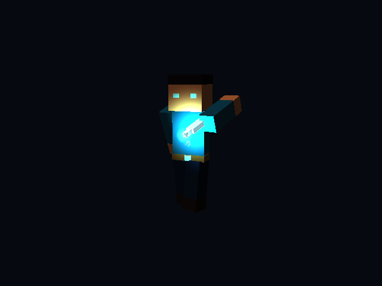

# ShardBound Studio no jogo

O executável ShardBound agora lê o contrato Studio v1 exportado pelo plugin 1.3.0 no Blockbench 5.2.2. O projeto editável `.sbstudio` continua no editor; o jogo recebe **a pasta exportada inteira**, com GLBs, quatro JSONs, sprites e áudio. Não precisa de MCP, ChatGPT ou Blockbench aberto para executar o conteúdo.

## Começar

Compile com `pwsh -File tools/build.ps1 release`. Para abrir a demonstração:

```powershell
./build/release/game.exe --mods examples/studio
```



Essa demonstração reproduz o ataque da espada de cristal no jogador real, com rastro, partículas, flash, brilho/luz e som. Seus arquivos estão em `examples/studio/studio_demo/sword`; o script que os usa está em `examples/studio/studio_demo/main.sl`.

## Importar seu pacote em um mod

1. No Studio, defina IDs como `meumod:espada`. O namespace dos modelos, do projeto e dos sons precisa coincidir com `id` em `mod.json`.
2. Exporte pelo menu **Arquivo → Exportar** do Blockbench. Preserve os GLBs e todos os arquivos auxiliares juntos.
3. Na raiz do repositório, execute:

```powershell
pwsh -File tools/import-studio.ps1 -Package 'C:/Exports/Espada' -Mod 'content/meumod'
```

O comando valida o pacote, copia somente as dependências declaradas e adiciona a entrada em `assets.json`, preservando as outras entradas. Para uma nova revisão do mesmo projeto, acrescente `-Update`: a revisão anterior e um backup do registro são preservados. O mod precisa existir e ter `mod.json`; a importação não inventa gameplay nem substitui seus scripts.

O caminho alternativo manual consiste em copiar a pasta para dentro do mod e declarar:

```json
{
  "studio": {
    "meumod:espada": { "source": "espada/studio.manifest.json" }
  }
}
```

Acrescente `studio` às outras seções existentes. A chave precisa ser o `project` exportado. **Não declare os mesmos modelos e sons também em `models`/`sounds`**: os IDs explicitamente listados no manifesto Studio já serão registrados. Efeitos são privados ao pacote; não invadem um registro global.

Para conferir sem abrir uma janela:

```powershell
./build/release/modcheck.exe --studio 'C:/Exports/Espada/studio.manifest.json'
./build/release/modcheck.exe content
```

O jogo lê mods relativos à pasta do executável, ou um caminho absoluto passado a `--mods`. A compilação copia `content` e `examples` para `build/<configuração>`. Depois de importar na pasta fonte, compile novamente ou execute com `--mods` apontando para a pasta `content` fonte. Reinicie o jogo depois de atualizar arquivos; não há recarga de arquivos em tempo real.

## Usar em scripts

```text
@Entities
entity MinhaEspada {
    Assets:
        .model = "meumod:espada"
}
entity MeuJogador {
    Assets:
        .model = "core:player"
}

@Events
on_start():
    jogador = spawn(MeuJogador, vec3(0, 0, 0))
    espada = spawn(MinhaEspada, vec3(0, 0, 0))
    studio_attach(espada, jogador, true)
    animation_play(espada, "attack")
```

Os IDs de entidades continuam distintos dos IDs dos modelos. Monstros não precisam da estrutura de seis membros; basta criar a entidade com seu modelo e tocar um clip. Blocos/itens estáticos não precisam de chamada de animação. Modelos de efeito podem não ter geometria: crie sua entidade e toque o clip que contém os eventos.

### Animações e equipamento

| Função | Comportamento |
| --- | --- |
| `animation_clips(entidade)` | Lista os nomes disponíveis. |
| `animation_has(entidade, nome)` | Verifica se o clip existe. |
| `animation_play(entidade, nome, modo?, velocidade?)` | Reinicia o clip. Modo padrão `authored`; aceita `once`, `loop`, `hold`. Velocidade 0,1–4. |
| `animation_current(entidade)` / `animation_time(entidade)` | Nome e relógio local, em segundos. Depois do fim, o relógio pode avançar para terminar as partículas. |
| `animation_pause(entidade, true/false)` | Pausa/retoma animação e vozes associadas. |
| `animation_seek(entidade, segundos)` | Reposiciona dentro do clip e encerra vozes anteriores. Não reproduz retrospectivamente os sons atravessados. |
| `animation_stop(entidade)` | Encerra clip, efeitos e sons; restaura a pose corporal. Equipamento anexado continua acompanhando o corpo. |
| `studio_attach(equipamento, jogador, dirigirPlayer)` | Alinha equipamento ao corpo pelos bindings exportados; redefine seu transform local para identidade. |
| `studio_detach(equipamento)` | Desfaz o vínculo; não para automaticamente um clip independente. |
| `is_studio_model(entidade)` | Identifica modelos carregados pelo registro Studio. |
| `studio_projectile_visual(entidade)` | Retorna o ID visual declarado ou `null`. |

Para armas que contêm poses do jogador, use `dirigirPlayer = true`; apenas um equipamento por jogador pode dirigir essa pose. Para armaduras use `false`: cada peça acompanha seu grupo corporal, inclusive quando outra arma dirige a animação. O jogador deve possuir os grupos `Head`, `Body`, `LeftArm`, `RightArm`, `LeftLeg`, `RightLeg`. O player nativo também é aceito. Equipamentos devem ser anexados diretamente ao jogador, não a outro equipamento.

As unidades do GLB já foram convertidas pelo exportador. Não reaplique `1/16`. Grupos, pivôs, escala e canais rígidos são preservados. Não há skinning por pesos. A retargetização no player nativo conserva seus pivôs e proporções; use um player Studio com a mesma geometria de referência para correspondência geométrica integral.

O pacote de aventura reconhece armas Studio no campo `model` de uma definição/instância de item. Ao equipar, anexa ao avatar e usa `idle`, `run`, `jump`, `attack` quando disponíveis. Trocar de arma e restaurar o save reconstituem o vínculo. Um modelo sem esses clips continua utilizável com a pose procedural. Monstros Studio usam seus clips nos estados equivalentes. O dano, alcance, colisões, velocidade, IA e regras de disparo continuam nos scripts de gameplay.

`core:arrow` é uma flecha visual compartilhada, orientada para o eixo local **-Z**, em metros. Mods podem declarar outro ID em `projectileVisual`. Essa propriedade seleciona a aparência: não cria projéteis nem define suas regras físicas.

### Eventos, VFX e sons

O relógio do clip dispara eventos em ordem `(time, order, id)`, inclusive ao atravessar frames e voltas do loop. `start` substitui a instância anterior; `stop` encerra a instância nomeada. Sons suportam volume, pitch, loop, WAV/OGG/MP3 e pausa global do jogo.

Partículas usam o mesmo gerador aleatório, formas, curvas e movimento analítico do preview Studio. Sprites usam nearest, atlas e alpha/aditivo. Rastros usam uma faixa de triângulos com histórico no espaço do mundo. Flash é uma sobreposição aditiva sobre a geometria, respeitando a máscara do material sem multiplicar a cor da textura. Glow combina sprite e luz pontual. Efeitos transparentes testam profundidade sem escrevê-la; seus buffers são reutilizados.

Cada entidade reproduz eventos cujo alvo pertence ao seu modelo. Eventos sem alvo e eventos do player de referência pertencem ao **primeiro modelo do manifesto**, evitando duplicar som/efeito em todos os modelos relacionados. Para garantir que um evento acompanhe um modelo independente específico, selecione uma pasta/marcador desse modelo como alvo no Studio. Flashes no player de referência exigem equipamento anexado a um jogador.

Destruir a entidade, trocar o modelo, parar o clip ou trocar o equipamento encerra suas vozes. Desativar a entidade pausa a reprodução. A pausa do jogo e minimização suspendem o relógio e o áudio. Saves preservam o conteúdo/estado de gameplay e remontam o equipamento; não serializam uma partícula individual nem retomam um som pela metade.

## Validação e limites reais

- Contratos v1: versões desconhecidas, IDs duplicados, arquivos ausentes, referências inválidas, curvas inválidas e caminhos fora da pasta são rejeitados. Áudio é decodificado durante a validação. O importador não reescreve os originais.
- GLB/GLTF exige buffers/imagens embutidos, materiais OPAQUE/MASK e canais rígidos LINEAR/STEP. O Studio exporta curvas complexas amostradas em LINEAR. Skinning, morph targets, CUBICSPLINE não amostrado e materiais GLB BLEND recebem erro.
- Orçamentos: 4.096 partículas por emissão, 32.768 simultâneas na cena, 32 luzes pontuais e 256 vozes. Modelos: até 10.000 nós e 2 milhões de amostras de canal. Arquivos GLB até 256 MiB; JSON até 64 MiB; som até 24 MiB. Exceder um orçamento gera diagnóstico; não há redução silenciosa do efeito.
- `once` e `hold` conservam a pose final; emissão termina e partículas/rastros existentes completam a duração. A troca de clip é imediata, sem crossfade. Um loop reinicia seus efeitos locais.
- Reprodução do áudio é 2D, como no preview do plugin. Não há espacialização por distância.
- **A equivalência pixel a pixel da iluminação do Blockbench e do jogo ainda não está comprovada.** A simulação de VFX tem comparação numérica com o código do preview; os dois renderizadores e seus ambientes de iluminação são diferentes. Isso não deve ser apresentado como fidelidade visual integral concluída.

## Verificação

`tools/build.ps1 debug` e `release` executam a suíte CTest. Os testes Studio cobrem importação/cache de animações, os nove tipos/modelos do pacote de autoria, validação negativa, eventos em loop, anexação e armaduras, renderização D3D11 com leitura dos pixels, troca/destruição/pausa, codecs WAV/OGG/MP3 e equipamento na aventura real. O exemplo também abre no executável por teste de fumaça.

`tests/fixtures/studio/effects-golden.json` foi gerado pelo código real de preview do plugin, via `node tools/studio-effect-golden.mjs`; não por uma segunda cópia C++ do algoritmo. A captura produzida pelo teste fica em `build/<configuração>/user/studio-preview/runtime.ppm`.
